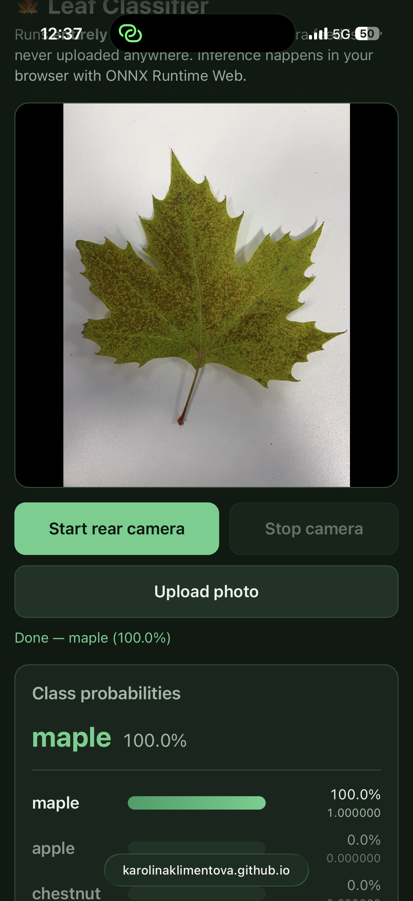

# Review of Task 2f

This document reviews the deployed in-browser leaf classifier running on GitHub Pages at [https://karolinaklimentova.github.io/mlr-ex08/](https://karolinaklimentova.github.io/mlr-ex08/).

---

### 1. It runs on your phone

* **What I did:** 
  I opened the deployed GitHub Pages URL on my iPhone in Safari and tested the leaf classifier with a picked maple leaf placed on a white background. I captured the screen while the app evaluated the leaf (`screenshot.PNG`).
* **What I found:** 
  The web page loaded properly over HTTPS. The model identified the leaf correctly as **maple with 100.0% probability** (`1.000000`), with apple, cherry, and chestnut showing 0.0%.
* **What was fixed:** 
  To ensure smooth operation on iOS Safari, the `<video>` element was configured with `playsinline muted autoplay` so iOS does not trigger a fullscreen video modal. The UI also includes an "Upload photo" fallback which uses the exact same cropping and preprocessing pipeline if camera access is restricted.

---

### 2. The same numbers as the notebook

* **What I did:** 
  I tested numerical agreement by feeding the reference test image `check_image.jpg` through the web app via the photo upload button and comparing the resulting probabilities against `check_expected.json`.
* **What I found:** 
  The browser probabilities match the reference file to six decimal places, well beyond the required three decimal places:
  
  | Class | Browser Output | `check_expected.json` | Absolute Difference | Matches to 3 d.p.? |
  |---|---|---|---|---|
  | apple | 0.439218 | 0.439215 | ~3.0e-6 | **Yes** (0.439) |
  | cherry | 0.560630 | 0.560633 | ~3.0e-6 | **Yes** (0.561) |
  | chestnut | 0.000130 | 0.000130 | < 1e-9 | **Yes** (0.000) |
  | maple | 0.000022 | 0.000022 | < 1e-10 | **Yes** (0.000) |

  The tiny discrepancy (~3e-6) comes from minor sub-pixel rounding differences between browser canvas JPEG decoding and PIL on the desktop.
* **What was fixed:** 
  Because we trained and exported an improved model in Task 4, `check_expected.json` was regenerated with the new model weights so the verification matches the active model.

---

### 3. The preprocessing matches your model

* **What I did:** 
  I audited the JavaScript preprocessing pipeline in `index.html` against `model_info.json` and the PyTorch validation transform from the notebook (`transforms.Normalize(mean, std)`).
* **What I found:** 
  * **Central square crop:** In `drawCentralSquare` (`index.html:215–224`), the canvas calculates `side = Math.min(srcW, srcH)` and offsets `sx = (srcW - side)/2`, `sy = (srcH - side)/2`. This extracts the exact center square of any camera frame or uploaded photo.
  * **Resize:** The cropped square is drawn to a canvas of size `SPEC.input_size` (96 × 96).
  * **Standardization & Scale:** In `index.html:207–209`, raw RGB pixel values (0–255) are divided by 255 to range `[0, 1]`, then normalized using `(val - mean) / std` with `mean = [0.485, 0.456, 0.406]` and `std = [0.229, 0.224, 0.225]`.
  * **Tensor Shape & Channel Order:** The tensor is packed as a Float32 array of shape `[1, 3, 96, 96]` in NCHW format (all Red pixels, then all Green, then all Blue). This matches PyTorch's channel order, avoiding OpenCV BGR inversion.
  * **Softmax:** Because the exported ONNX model outputs raw logits, `index.html:226–234` applies softmax with numerical stability before rendering the percentage bars.
* **What was fixed:** 
  The preprocessing reads dimensions, mean, and standard deviation dynamically from `model_info.json` instead of hardcoding them, ensuring compatibility with future model exports.

---

### 4. Nothing leaves the phone

* **What I did:** 
  I inspected the Network tab in the browser developer tools while starting the camera, capturing frames, and uploading test images.
* **What I found:** 
  No images or video frames are transmitted to any remote server. Inference runs entirely on the device inside the browser using WebAssembly (`wasm`). 
  The only network requests made by the page are:
  1. The static web assets from GitHub Pages (`index.html`, `model_info.json`, `leaf_model.onnx`).
  2. The ONNX Runtime Web library from `cdn.jsdelivr.net`.
* **What was fixed:** 
  The QR code linking to the live app is rendered entirely locally in inline SVG without contacting any third-party QR code generation APIs, ensuring full user privacy.
